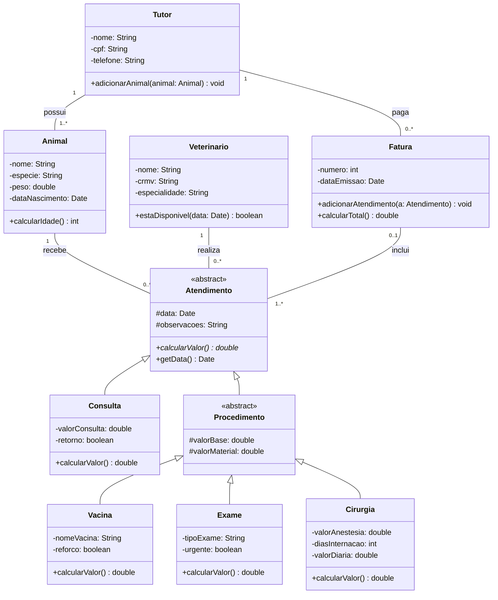

# Diagrama de classes de uma clínica veterinária

Trabalho da disciplina de Engenharia de Software, UniCesumar, 2026.

**Integrantes:**
- Fernando César de Oliveira Junior
- Gustavo Starke Brandt

**Tema:** Diagrama de classes: generalização, classe abstrata e polimorfismo

## Cenário

Sistema de atendimentos e faturamento de uma clínica veterinária. O tutor pode ter um ou mais animais, e cada atendimento é feito por um veterinário, para um animal, em uma data. A clínica oferece quatro tipos de atendimento, e cada um é cobrado de um jeito:

- **Consulta:** valor fixo. O retorno em até 15 dias é gratuito.
- **Vacina:** taxa de aplicação mais o valor da dose. A dose de reforço cobra só a dose.
- **Exame:** valor do exame mais o material, com acréscimo de 30% quando é urgente.
- **Cirurgia:** valor do procedimento, material, anestesia e diárias de internação.

No fim, a clínica emite para o tutor uma fatura com os atendimentos, e o total é a soma do valor de cada um.

No modelo, `Atendimento` e `Procedimento` são classes abstratas, a hierarquia tem três níveis e o método abstrato `calcularValor()` é sobrescrito em `Consulta`, `Vacina`, `Exame` e `Cirurgia`. O polimorfismo está em `Fatura.calcularTotal()`, que soma uma lista de `Atendimento` sem precisar saber o tipo de cada um.

## Arquivos

| Arquivo | Descrição |
|---|---|
| [docs/trabalho-diagrama-de-classes.pdf](docs/trabalho-diagrama-de-classes.pdf) | Trabalho escrito (PDF) |
| [diagramas/diagrama-classes.mmd](diagramas/diagrama-classes.mmd) | Diagrama de classes completo: arquivo-fonte |
| [diagramas/diagrama-classes.png](diagramas/diagrama-classes.png) | Diagrama de classes completo: imagem exportada |
| [diagramas/hierarquia-atendimentos.mmd](diagramas/hierarquia-atendimentos.mmd) | Hierarquia de herança dos atendimentos: arquivo-fonte |
| [diagramas/hierarquia-atendimentos.png](diagramas/hierarquia-atendimentos.png) | Hierarquia de herança dos atendimentos: imagem exportada |

## Diagrama de classes

Os diagramas foram feitos na ferramenta [Mermaid](https://mermaid.js.org/). O código abaixo é o mesmo do arquivo [diagrama-classes.mmd](diagramas/diagrama-classes.mmd), e o GitHub mostra o diagrama a partir dele.



Para editar, basta abrir o arquivo `.mmd`, colar o conteúdo no [Mermaid Live Editor](https://mermaid.live) e exportar a imagem em PNG.

## Estrutura do repositório

```
├── README.md
├── docs/
│   └── trabalho-diagrama-de-classes.pdf
└── diagramas/
    ├── diagrama-classes.mmd
    ├── diagrama-classes.png
    ├── hierarquia-atendimentos.mmd
    └── hierarquia-atendimentos.png
```
